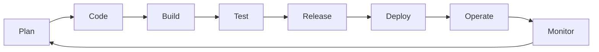
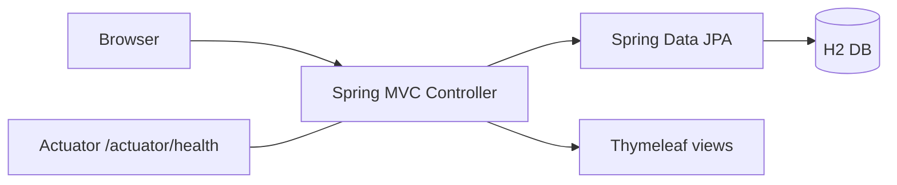

# Tasks 1-3: Planning, Agile, Architecture (ready-to-edit drafts)

## Task 1 - Problem definition & scope
**Problem:** Data teams re-upload datasets under names like `final_v2_new.csv`, so nobody knows which version trained which model.
**Solution:** A web portal that stores dataset records with an ordered version history and a Draft -> In Review -> Approved workflow.
**Users / stakeholders:** Data scientist (submits), Reviewer (approves), Admin (manages), Project guide (evaluates).
**Constraints:** 15 tasks, single developer, free tooling (GitHub, Jenkins, Docker Hub), runs on a laptop.
**Success criteria:** create/search a dataset in < 3 clicks; every version traceable; commit-to-container pipeline < 10 min; all UI tests green.
**MVP scope:** create, view, update, search; role-based status workflow; version history; summary dashboard.
**Out of scope:** real file storage, SSO, multi-tenant.

## Task 2 - Agile plan
| ID | User story | Acceptance criteria |
|----|-----------|---------------------|
| US1 | As a data scientist I create a dataset record | Name/owner required; v1 auto-created |
| US2 | As a user I search datasets | Matches name or owner, case-insensitive |
| US3 | As a user I add a new version | Version increments; blocked once Approved |
| US4 | As a user I submit for review | Only DRAFT -> IN_REVIEW |
| US5 | As a reviewer I approve/reject | Only REVIEWER/ADMIN; USER is refused |
| US6 | As a manager I see a dashboard | Counts by status |

**Board:** Backlog -> In Progress -> Review -> Done, one card per task (T1-T14).
**Sprints:** S1 = T1-T6, S2 = T7-T10, S3 = T11-T14.
**Definition of Done:** code reviewed via PR, unit + Selenium tests pass in Jenkins, image builds, docs updated.

**DevOps lifecycle:**

## Task 3 - Architecture

**Stack:** Java 17, Spring Boot 3.2, Thymeleaf, JPA/H2, Maven, Tomcat (WAR) or Docker (JAR).
**Data model:** Dataset(id, name, description, owner, format, status, createdAt) 1--* DatasetVersion(id, versionNo, notes, sizeMb, createdBy, createdAt).

| Method | Path | Purpose |
|---|---|---|
| GET | `/` | Dashboard + search (`?q=`) |
| GET/POST | `/datasets/new`, `/datasets` | Create |
| GET | `/datasets/{id}` | View |
| GET/POST | `/datasets/{id}/edit`, `/datasets/{id}` | Update |
| POST | `/datasets/{id}/versions` | Add version |
| POST | `/datasets/{id}/status` | action = submit / approve / reject |
| POST | `/role` | Switch role (USER, REVIEWER, ADMIN) |
| GET | `/actuator/health` | Health check |

**Use cases:** Create dataset, Search, Add version, Submit (User); Approve/Reject (Reviewer); Delete (Admin).
